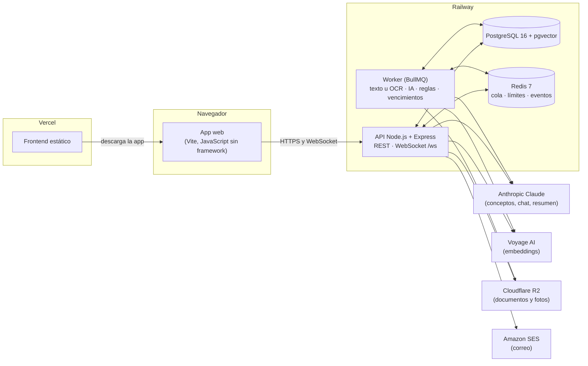
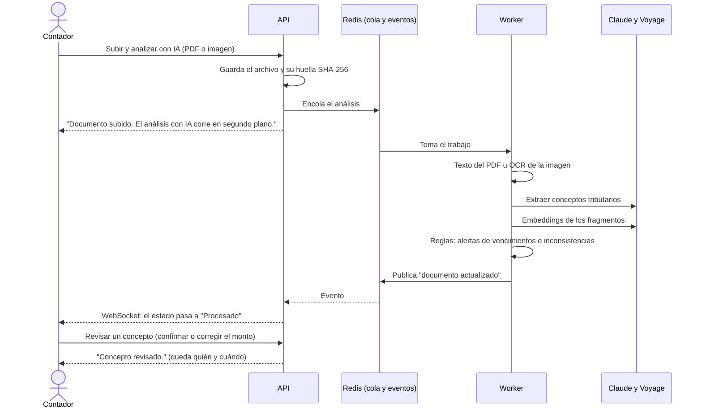

# Renta IA: gestión documental contable con inteligencia artificial

**Producción:** aplicación en <https://renta.jonarproyectos.com> · API en
`api-renta.jonarproyectos.com` (estado: [`/ready`](https://api-renta.jonarproyectos.com/ready)).

Este README es la guía para evaluar el proyecto completo sin ayuda. El proyecto vive en tres
repositorios; este (`renta-ia-backend`) es el principal y tiene la guía de pruebas. Los otros dos
explican su parte y enlazan aquí:

| Repositorio         | Qué contiene                                                                                         |
| ------------------- | ---------------------------------------------------------------------------------------------------- |
| `renta-ia-backend`  | **Este.** API REST, WebSocket, worker de documentos con OCR e IA, alertas, correo y archivos.        |
| `renta-ia-frontend` | La aplicación web: clientes, documentos, conceptos, alertas, resumen, chat, cuenta y administración. |
| `renta-ia-database` | El esquema de PostgreSQL (migraciones SQL), los datos de prueba y el diagrama de la base.            |

## Contenido

1. [Qué es el proyecto](#1-qué-es-el-proyecto)
2. [Cómo funciona](#2-cómo-funciona)
3. [Tecnologías](#3-tecnologías)

## 1. Qué es el proyecto

**Renta IA** ayuda a una firma contable a preparar la declaración de renta de sus clientes. El
contador sube los soportes del cliente (certificados de ingresos, extractos, facturas…); un proceso
en segundo plano lee el texto (con OCR si es una imagen), una IA extrae las cifras tributarias, un
motor de reglas genera alertas (vencimientos e inconsistencias) y un chat responde preguntas sobre
el cliente usando solo sus documentos (RAG). Lo que extrae la IA queda marcado **"sin revisar"**
hasta que una persona lo confirma con el documento original al lado. Está pensado para contadores,
sus asistentes y los propios contribuyentes, que consultan su expediente en un portal de solo
lectura.

Capacidades principales:

- **Clientes** de cada contador, con aislamiento estricto entre contadores.
- **Subida de documentos** (PDF, JPG o PNG, hasta 15 MB) con análisis automático: texto u OCR,
  conceptos tributarios con IA y embeddings para el chat.
- **Revisión humana** de cada concepto extraído, con el **visor del original** y una vista dividida.
- **Alertas** de vencimientos e inconsistencias, y un **resumen** con estimación simplificada del
  impuesto.
- **Asistente de IA** que responde preguntas sobre un cliente con sus propios documentos.
- **Tiempo real**: el estado de cada documento se actualiza solo.
- **Cuentas** solo por invitación, con verificación en dos pasos (obligatoria para el
  administrador), recuperación de contraseña, sesiones activas, perfil con foto, exportación y
  eliminación de la cuenta.
- **Administración**: invitaciones, reasignación de clientes y métricas de rendimiento web.

## 2. Cómo funciona

### El recorrido de principio a fin

1. **El administrador invita** a contadores, asistentes (ligados a un contador) y contribuyentes
   (ligados a su expediente). Cada persona recibe un enlace por correo y elige su contraseña.
2. **El contador crea un cliente** y **sube un documento**. La API guarda el archivo, calcula su
   huella (SHA-256, para detectar duplicados) y encola el análisis; responde al instante.
3. **El worker** (un proceso aparte que atiende la cola en Redis) extrae el texto del PDF, o lo
   reconoce con OCR si es una imagen, pide a Claude los conceptos tributarios (ingresos,
   retenciones, deducciones, aportes), calcula los embeddings con Voyage y corre las reglas que
   generan alertas.
4. **El navegador se entera solo:** el worker publica el cambio, la API lo envía por WebSocket y la
   tabla de documentos pasa de "Procesando" a "Procesado" sin recargar.
5. **El contador revisa** cada concepto con el original al lado y lo confirma o corrige; queda quién
   y cuándo, y se conserva lo que leyó la IA.
6. **Pregunta y resume:** el asistente de IA responde con fragmentos de los documentos de ese
   cliente, y el resumen calcula una estimación simplificada del impuesto.
7. **El contribuyente** entra a su portal y ve su expediente, solo con lo ya revisado.

### Arquitectura

El DNS está en Cloudflare. La aplicación (`renta.`) y la API (`api-renta.`) son orígenes distintos del
mismo sitio: la cookie de sesión viaja entre los dos y la API responde con CORS solo al origen de la
aplicación.

### Flujo principal: subir un documento y revisarlo

Más detalle: el pipeline y las respuestas del modelo en la
[referencia técnica](docs/referencia-tecnica.md#pipeline-de-ia), las decisiones en
[docs/adr/](docs/adr/README.md), el modelo de dominio en
[renta-ia-database](https://github.com/Jonar519/renta-ia-database/blob/main/docs/modelo-de-dominio.md) y
el contrato de la API en [docs/openapi.json](docs/openapi.json).

## 3. Tecnologías

Versiones: los rangos declarados en el `package.json` de cada repositorio, el `Dockerfile` y el
`docker-compose.yml`.

| Tecnología                                            | Versión                              | Para qué se usa                                                                        | Por qué se eligió                                                                                                        |
| ----------------------------------------------------- | ------------------------------------ | -------------------------------------------------------------------------------------- | ------------------------------------------------------------------------------------------------------------------------ |
| **Node.js**                                           | 20 (imagen `node:20-bookworm-slim`)  | API y worker                                                                           | Un solo lenguaje con el frontend; buen manejo de E/S y colas.                                                            |
| **TypeScript**                                        | ^5.5.4                               | Lenguaje del backend                                                                   | Tipos en los contratos entre módulos.                                                                                    |
| **Express**                                           | ^4.19.2                              | API REST (rutas → esquema → controlador → servicio)                                    | Estándar conocido, middlewares simples.                                                                                  |
| **zod**                                               | ^3.23.8                              | Validación de entradas y configuración; genera `docs/openapi.json`                     | Errores claros por campo; un test falla si la documentación queda desactualizada.                                        |
| **ws**                                                | ^8.22.0                              | WebSocket `/ws` para el estado de los documentos                                       | Autenticación en el primer mensaje y control del `Origin`.                                                               |
| **PostgreSQL + pgvector**                             | imagen `pgvector/pgvector:pg16`      | Datos, reglas de la base y vectores para el chat                                       | Una sola base para datos y embeddings; la base impide estados inválidos (por ejemplo, sesiones de una cuenta pendiente). |
| **Prisma**                                            | ^5.19.0                              | Cliente tipado de la base                                                              | Solo como cliente: el esquema lo manda SQL puro.                                                                         |
| **Redis** (ioredis) + **BullMQ**                      | `redis:7-alpine` · ^5.4.1 · ^5.12.0  | Cola de documentos, tareas programadas, límites de uso y eventos                       | El análisis no bloquea la subida; varias instancias comparten estado.                                                    |
| **Anthropic Claude** (`@anthropic-ai/sdk`)            | ^0.27.3                              | Extracción de conceptos, chat y resumen                                                | Detrás de un proveedor intercambiable (`AI_PROVIDER=mock` solo para E2E y carga).                                        |
| **Voyage AI**                                         | embeddings de 1024 dimensiones       | Búsqueda de fragmentos para el chat (RAG)                                              | Recomendado para Claude; se llama por HTTP.                                                                              |
| **pdf-parse** · **tesseract.js**                      | ^1.1.1 · ^5.1.1                      | Texto de los PDF y OCR de las imágenes (español)                                       | Sin servicios externos para leer documentos.                                                                             |
| **AWS SDK S3** (con **Cloudflare R2**)                | `@aws-sdk/client-s3` ^3.1146.0       | Documentos originales y fotos de perfil                                                | Interfaz de almacenamiento intercambiable; en local, disco.                                                              |
| **AWS SDK SES v2** (con **Amazon SES**)               | `@aws-sdk/client-sesv2` ^3.1146.0    | Invitaciones, recuperación, cambio de correo y avisos                                  | En desarrollo, `EMAIL_PROVIDER=mock` guarda los correos en una tabla.                                                    |
| **jsonwebtoken** · **bcrypt**                         | ^9.0.2 · ^6.0.0                      | Token de acceso de 15 min y contraseñas                                                | Token en memoria y renovación con cookie httpOnly rotativa.                                                              |
| **helmet** · **pino** · **prom-client**               | ^7.1.0 · ^10.3.1 · ^15.1.3           | Cabeceras de seguridad, logs sin datos sensibles y métricas                            | Operación: `/health`, `/ready` y `/metrics`.                                                                             |
| **Vite** · **pdf.js** · **web-vitals** (frontend)     | ^7.3.7 · 6.4.299 · ^6.2.2            | Build, visor del original y métricas de rendimiento reales                             | Visor sin plugins y medición de la experiencia en producción.                                                            |
| **Vitest** · **Supertest** · **Playwright** · **axe** | ^4.1.12 · ^7.3.0 · ^1.63.0 · ^4.13.0 | Pruebas unitarias, de integración, E2E y accesibilidad                                 | Integración contra una base de pruebas creada desde cero con las migraciones reales.                                     |
| **ESLint** · **Prettier**                             | ^10.11.0 · ^3.9.9                    | Reglas y formato                                                                       | La CI los exige.                                                                                                         |
| **GitHub Actions** · **gitleaks**                     | gitleaks `v8.21.2`                   | CI: lint, tipos, tests, build, `npm audit` y búsqueda de secretos                      | Nada llega a `main` sin pasar todo.                                                                                      |
| **Docker**                                            | `node:20-bookworm-slim`              | Una imagen para la API y el worker; PostgreSQL y Redis en desarrollo                   | El mismo artefacto en local y en Railway, sin usuario root.                                                              |
| **Railway** · **Vercel** · **Cloudflare**             | —                                    | API, worker, PostgreSQL y Redis en Railway; frontend en Vercel; DNS y R2 en Cloudflare | HTTPS automático y dominios propios.                                                                                     |
